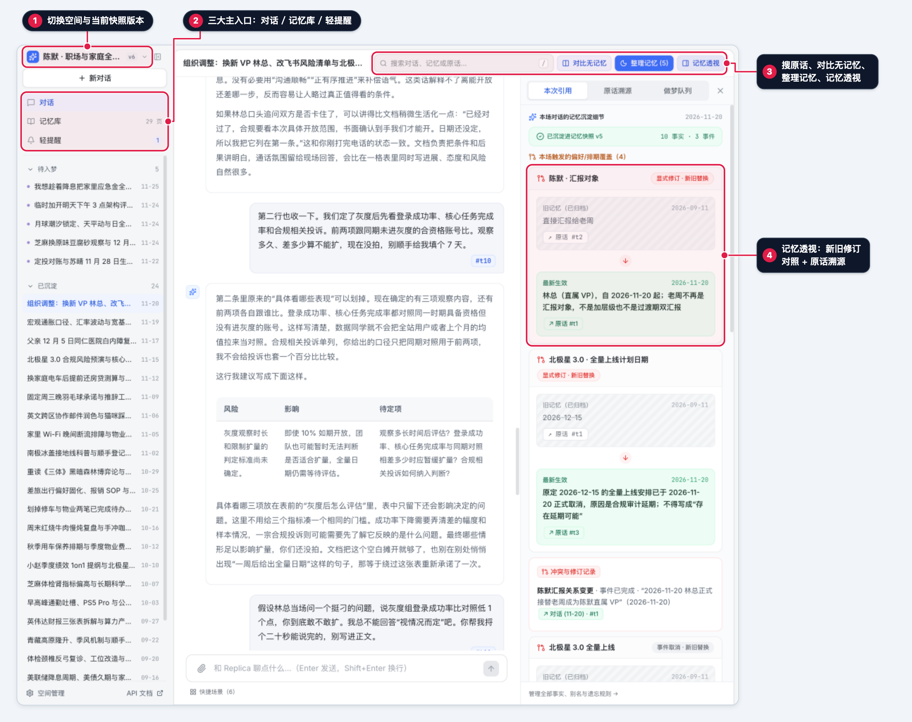
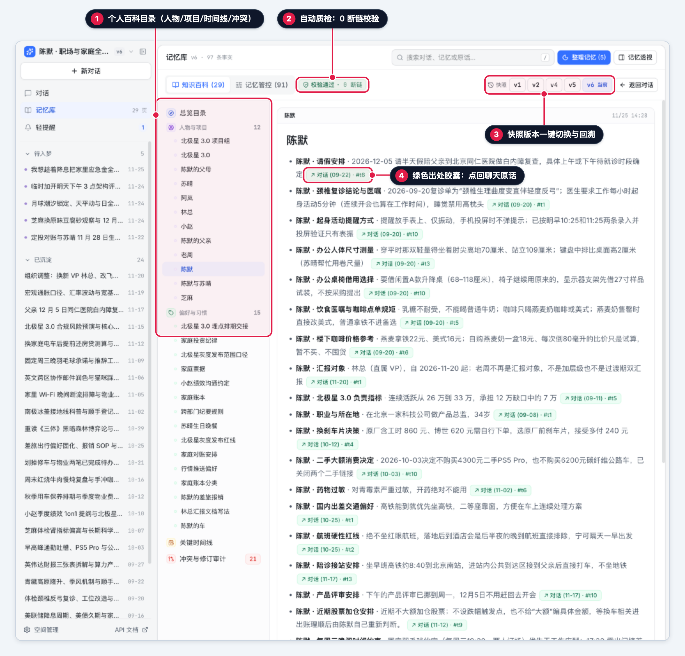
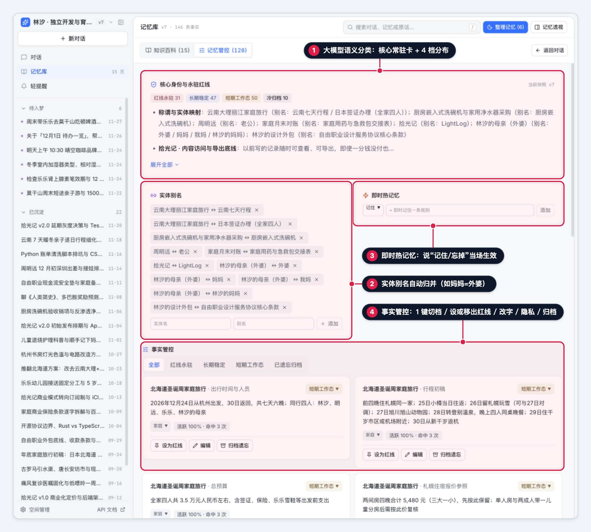
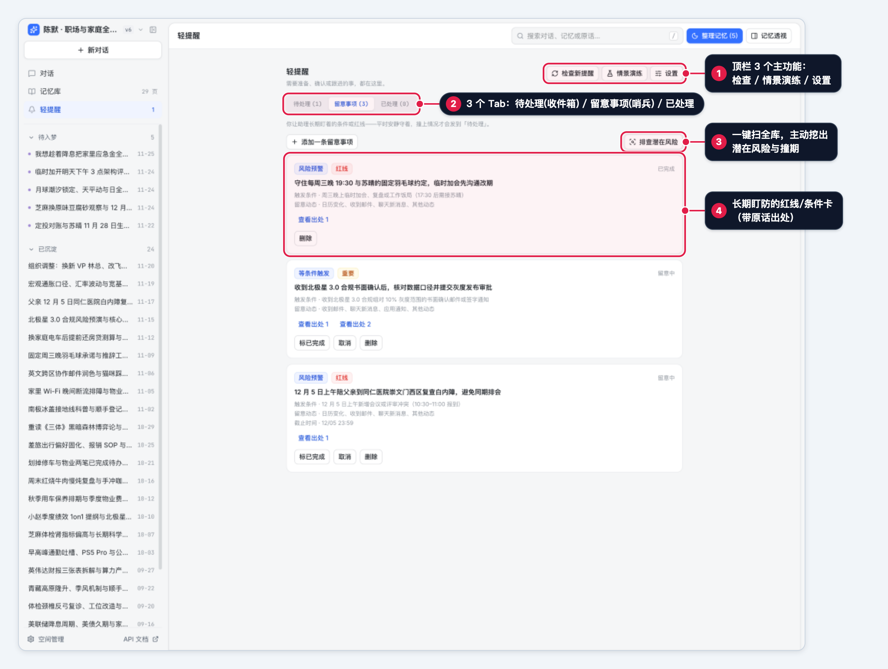
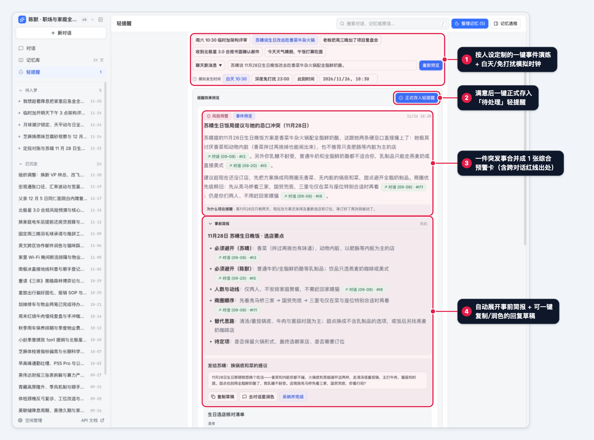

# 记忆方案说明

一句话概括：**不把聊天记录切碎扔进黑盒向量库，而是给 AI 建一本“带目录、贴红线、能查出处、会自动整理”的个人百科（Markdown Wiki）**，再配合实时便签、原始存档和克制的主动提醒。

整个方案拆成 **存、写、读、推** 四个部分（每部分都附了界面实景图与具体例子，需要时可点开看）：



---

## 一、记忆存的什么：4 层分工 + 4 档保质期

### 1. 按用途分 4 层

| 层级 | 是什么 | 什么时候生效 | 解决什么问题 |
| :--- | :--- | :--- | :--- |
| **1. 核心常驻卡** | 贴在屏幕边上的“红线便利贴”：人物关系/别名、过敏医嘱、财务合规底线、核心规矩 | 每次对话默认带着，不用搜 | 防止提问没带关键词时漏掉关键红线（比如问“给孩子买什么零食”没提“过敏”） |
| **2. 即时热记忆** | 聊天里直接说的“记住 xx / 忘掉 xx / 以后叫我 xx” | **当场生效**，优先级最高 | 不用等后台慢慢整理，刚改口下句话就生效；整理进 Wiki 后自动退场 |
| **3. 长期个人 Wiki** | 整理好的 Markdown 笔记，分了总目录、人物/项目页、时间线、行为准则、冲突修订页 | 后台整理发版后生效 | 把分散在不同天的碎片归拢去重，人眼直接能看懂、能检查 |
| **4. 原始档案柜** | 所有聊天原话和上传的文件（PDF/Word/MD 等），按页/段/轮次打好坐标 | **发完/传完立刻可搜** | 保证每条记忆都能点回原文核对，同时兜住刚聊完还没整理的对话 |

其中，长期 Wiki 里有三个关键页面：
- **总目录（`_index.md`）**：列清所有页面和一句话摘要，强制限制大小（最多 200 行），避免越攒越长；
- **时间线（`timeline.md`）**与**行为准则（`rules.md`）**：把“带日期的安排”和“教过 AI 的做事规矩”单独拎出来；
- **冲突与修订（`conflicts.md`）**：旧方案、改过的价格、取消的行程不会悄悄删掉，而是挪到这里留底。平时问答默认不翻它，只有追问“之前怎么定的 / 为什么改了”才查。



### 2. 每条记忆分 4 档保质期（界面上的「事实管控」）

为了防止旧琐事越积越乱，系统在沉淀每条事实时，由**大模型按语义统一判断**它的保质期档位与隐私范围（不再靠关键词正则硬猜，避免普通家庭旅行或单日安排只因提到家人就被误标成红线）：

- **红线永驻**：过敏、医嘱、家庭核心关系、绝对底线（或你手动设为红线的），**永远不淡忘**。
- **长期稳定**：长期有效的事实（如习惯、现行定价），淡忘很慢（半衰期约 180 天），而且**每次被用到都会重新“加深印象”**。
- **短期工作态**：阶段性的事（如一次出差、临时待办、草稿排期），淡忘较快（半衰期约 20 天）；一次性带日期的安排（如某天复查、阶段性出差/旅行）会自动归为短期工作态并附带**到期日**（卡片显示 `到期 YYYY-MM-DD`），过日自动退场，不干扰现在的工作。
- **冷归档 / 已遗忘归档**：已经结束的事（如已完成的项目）或你手动归档的条目，退出活跃记忆，但保留记录，手动归档的随时可恢复。

此外，每条记忆还由大模型语义标注**隐私标签**（私密健康 / 家庭 / 内部工作 / 对外可用 / 通用），并且在界面里可以随时手动操作：支持**1 键下拉切换档位（红线永驻 / 长期稳定 / 短期工作态）**、**一键「设为红线 / 移出红线」**、修改文字、改隐私范围、归档恢复与管理实体别名（比如把“我妈”和“外婆”关联成同一个人）。



<details>
<summary>📌 举个例子：以内置的「林汐」空间为例，4 层和 4 档里具体存了什么？</summary>

- **4 层里分别放着**：
  1. **核心常驻卡**：`林汐的母亲（别名：外婆/妈妈/我妈）`、`周明远（别名：老公）`、`乐乐重度花生和腰果过敏，误食立即用肾上腺素笔送浙大儿院`。
  2. **即时热记忆**：林汐刚在聊天里说“记住：下周二我自己接乐乐，不用外婆去了”，系统立刻贴成一条最高优先级便签，不用等整理，下一句就生效。
  3. **长期个人 Wiki**：自动分成 `乐乐`、`周明远`、`拾光记`、`云南大理丽江家庭旅行` 等独立页面；`timeline.md` 按日期列出每周接送和复诊安排；`conflicts.md` 记着“拾光记从 18 元买断改为 68 元/年”的修改记录。
  4. **原始档案柜**：每条记忆末尾都挂着类似 `[src:doc_47fa...#t4]` 的坐标，点一下就能弹出当时聊天第 4 轮的原话（上传的 PDF 则定位到第几页 `#p3`）。

- **4 档保质期怎么分**：
  - **红线永驻**：乐乐花生过敏急救方案、外婆高血压医嘱（永远满血，不衰减）。
  - **长期稳定**：拾光记现行年费 68 元、乐乐睡前阅读偏好（慢慢淡，常用就加深）。
  - **短期工作态**：`北海道圣诞周旅行` 相关行程初稿与出行安排（普通旅行不再误标为红线，取消后的日程同步撤出时间线）、周明远下周深圳出差、厨房洗碗机安装验收（一次性带日期安排附带到期日，过日自动退场）。
  - **冷归档**：已结束的“茶铺字标外包项目”，或你手动归档的条目（退出活跃记忆，不再干扰当前回答，手动归档的随时可恢复）。

</details>

---

## 二、记忆怎么写进去：快车道 + 慢车道（做梦整理）

写入分成两条线，既保证聊天不卡顿，又保证长期记忆干净有序：

### 1. 快车道（零等待）
- 聊过的每一句话立刻存库并建好索引，**1 秒后就能在别的对话里搜到**（状态标为「待入梦」）；
- 说到“记住/忘掉”口令，当场写进热记忆立刻生效；
- 在管控面板里手动改字、切换档位 / 设或移出红线、归档，立刻生效。

### 2. 慢车道（上传文档 / 做梦整理）
上传文件后，或者点击「做梦整理」（也可定时自动触发）把待整理的对话打包进来，后台先**复制一份草稿在隔离区里改**，绝不边改边影响线上聊天。共走 6 步：

```text
原始文件/对话
  → ① 去重与打坐标（同一份文件不重复花钱；扫描件无文字层自动跳过）
  → ② 多人并行摘录（最多 6 路同时抽：事实、别名、时间线、准则、未来留意事项，同时由大模型语义标注每条事实的保质期档位、到期日与隐私范围，过滤闲聊）
  → ③ 程序按规则裁决冲突（明说修改优先 > 日期更新优先；同一天打架则两边都留证）
  → ④ AI 主编整理 / 做梦大扫除（合并同名人物和重复事实、归档过期货、回看原文纠错、消化热记忆）
  → ⑤ 自动质检（检查断链、目录超长、每句话必须有真实出处、不准偷删活跃事实，不过就打回）
  → ⑥ 一键发版新快照（v1 → v2 → v3…，支持随时回滚）
```

两个省钱又省心的细节：
- **老对话增量处理**：以前整理过 10 轮的对话今天又续聊了 2 轮，只抽新增的 2 轮，前面直接复用。
- **删除聊天不留“幽灵记忆”**：删掉某段对话时，系统会顺着坐标把只靠它支撑的记忆干净撤回，哪怕被合并进了别的条目里也会自动拆回，不让删掉的内容借尸还魂。

<details>
<summary>📌 举个例子：一次“产品改价 + 行程取消”，是怎么被写进 Wiki 的？</summary>

假设林汐在 10 月聊过“拾光记定价 18 元买断”和“年底去北海道”，11 月又新聊了一段“18 元买断下架，改成 68 元/年订阅；北海道取消了，改去云南大理丽江”，同时提到“老公 12 月 2 日去深圳出差”：

1. **聊天刚结束（快车道）**：这段新对话立刻标为「待入梦」并建好索引。林汐马上开个新窗口问“拾光记现在卖多少钱”，已经能搜到这轮原话，不会失忆。
2. **点「做梦整理」（慢车道 6 步）**：
   - **去重打标**：把对话按问答轮次切成 `#t1、#t2…`（如果之前整理过前 10 轮、这次续聊了 2 轮，只抽新增的 2 轮）。
   - **并行摘录**：摘录员看到已有别名表里 `周明远 = 老公`，自动把出差记录挂到 `周明远` 名下，顺手过滤掉中间的闲聊。
   - **程序裁决冲突**：程序对比发现“拾光记定价”出现显式修改且日期更新，自动让 `68 元/年` 胜出，把旧的 `18 元买断` 连同原出处挪进 `conflicts.md`；北海道日程状态变为“已取消”，自动撤出 `timeline.md`。
   - **主编大扫除**：把早就结束的 10 月份外包项目挪进冷归档；发现某条记录含糊时，还能自己翻回去读那一轮原话核对改对。
   - **质检发版**：确认没有断链、没有漏掉必留事实、每条都有真实 `[src:...]` 出处后，瞬间从 `v6` 切换到 `v7`。
3. **如果事后删掉这段对话**：系统会顺着这段对话的文档号，把只靠它支撑的新记忆全部撤回，不会留下“删了聊天 AI 还记得”的残留。

</details>

---

## 三、提问时怎么读出来：先分流、双通道查、防泄密、核出处

你问一个问题后，系统按 5 步把记忆调出来：

1. **先判断要不要查记忆（路由分流）**
   - 路由分流（是否查记忆、热记忆口令识别、对外隐私隔离、安全红线加权、是否查历史修订 `conflicts.md`）**均由大模型统一语义判断**，不靠容易误伤的字面关键词正则抢跑。
   - 问通用常识（比如“手冲咖啡水温多少”）？直接正常回答，不乱翻你隐私，也不说“记忆里没查到”这种尬话。
   - 复杂问题自动补全代词并拆成 2～3 个小查询（比如把“他周六几点接”补全成“乐乐周六几点接”）。
   - 自动识别场景开关：聊吃喝/看病/花钱/日程自动打开**安全红线加权**；起草对外邮件或公开文档自动打开**对外隐私隔离**。

2. **双通道同时找资料**
   - **通道 1 · 查长期 Wiki**：先自动带上人物别名，再用**“AI 看目录挑页 + 关键词搜索 + 语义匹配”**三路混合找，必要时还能顺着页面里的链接多翻一页。
   - **通道 2 · 直搜历史原话**：专门补足**还没整理进 Wiki 的新对话**和具体原话细节；多个子问题轮流取名额，防止某一段长聊天霸屏。

3. **对外写稿自动屏蔽隐私**
   一旦触发**对外隐私隔离模式**，读取时会自动把「私密健康 / 家庭 / 内部工作」相关条目逐行抠掉，并且**关闭原话直搜**，确保私人信息绝不会带进给客户的邮件或公开文档里。

4. **控制字数 + 长对话自动压缩**
   - 召回的内容超过字数上限时，只保留最相关的行，并优先保底过敏/医嘱/底线行不被截断；
   - 单次聊天太长（超过 24 条消息或 6000 tokens），自动把更早的对话压成“目标、约束、决定、待解问题”的摘要，完整留住最近 8 轮。
   - 界面支持打开**「对比无记忆」**，同时输出“有记忆”和“无记忆”两份回答左右对照，并在右侧**「记忆透视」**里查看本次引用、新旧修订对照与原话溯源。

5. **出口核对出处 + 反哺热度**
   - 发给你之前，系统会逐条核对回答里的 `[src:...]` / `[chat:...]` 标签，**AI 自己瞎编的假出处会被直接删掉**，保留下来的点一下就能回看原文；
   - 这次回答里真正用到的记忆，系统会自动给它**「命中次数 +1」并刷新时间**，让常用记忆越用越牢。

<details>
<summary>📌 举个例子：3 种不同提问，系统分别是怎么读记忆的？</summary>

- **场景 1（日常提问暗藏红线）**：林汐问**“明天带乐乐去吃云南米线，要注意什么？”**
  1. 路由识别涉及“孩子 + 吃饭”，自动亮起**安全红线开关**；
  2. **常驻红线卡**直接兜底：乐乐重度花生/腰果过敏；
  3. **通道 1（Wiki）**翻出 `乐乐` 页和 `云南旅行` 页，调出外出用餐红线（米线小料不放心、共用炸油直接换菜、随身带肾上腺素笔、急诊送浙大儿院）；**通道 2（原话）**顺便查最近刚聊完还没入梦的新对话里有没有临时变动；
  4. 生成回答并核验每个 `[src:...]` 标签真实有效，同时给“乐乐过敏”这条记忆**命中次数 +1**。

- **场景 2（对外写稿防泄密）**：林汐问**“帮我给客户起草一封设计外包的报价确认邮件”**
  1. 路由识别出“给客户起草邮件”，立刻切到**对外隐私隔离模式**；
  2. 系统在读取时自动把健康医疗（乐乐过敏、妈妈高血压）、家庭私事、内部敏感条目全部过滤掉，并且**直接关掉通道 2（历史原话）**；
  3. 只把可对外使用的“外包预付款/尾款规则”拿出来起草邮件，绝不漏出一句家里隐私。

- **场景 3（纯常识问答）**：林汐问**“手冲咖啡水温一般多少度？”**
  - 路由直接判定为通用常识，**完全不查记忆库**，直接自然解答。

</details>

---

## 四、主动推送（轻提醒）怎么做：该说才说、绝不瞎打扰

系统不只等你问才答，还会从记忆里长出克制的**轻提醒（Whisper）**。

### 1. 提醒从哪来（4 种触发 + 6 源本地快筛）
- **日程与到期日**：重要日程自动埋好“前一天早 9:00 + 当天早 8:30”提醒；临期事项前一天提醒；可选开启每日轻简报汇总未来 3 天安排。
- **待确认冲突**：同一天出现无法自动裁决的矛盾说法，提醒你拍板。
- **留意事项 + 风险排查**：除了对话里提取或你手动加的提醒条件，系统还能一键横向扫描整个记忆库，主动揪出**日程撞车、红线冲突、久未闭环的悬案**。
- **外部事件（6 源本地 L1 快筛）**：收到新消息、邮件、日历变更或应用通知时，**先在本地低成本快筛 6 类信息源**——`留意事项`、`红线`、`行为准则`、`有效未来日程`（支持中文日期解析与新增日程撞期检测）、`高相关事实`、`已有提醒`，总召回上限卡在 **6 条** 防止噪声干扰。
  - 只有真的撞上你的留意事项、日程或红线，才唤醒大模型研判；
  - 碰到无关闲聊（如“今天天气晴朗，午饭打算吃面”），本地直接跳过、**0 模型调用**保持安静；
  - **一件突发事件最多合并成 1 张综合提醒卡**，不会拆成好几条连续轰炸，同时自动展开**事前简报**（附跨对话红线出处），并准备好可**一键复制**或**去对话里润色**的回复草稿。

### 2. 怎么做到不烦人（6 道硬护栏）
触发后先由模型判断“现在值不值得打扰你”（划不来就保持安静），并顺手准备好**提醒原因、事前简报、建议动作、回复草稿和原文出处**；真正发出来前，程序还会卡死 6 道硬规矩：
1. **每天有推送上限**，超额不发；
2. **冷却期与去重**，同一件事不反复弹；
3. **安静时段（免打扰）**：晚上普通提醒自动延后到白天；就算模型标了“紧急”，程序也要复查是不是真涉及红线/风险/2 小时内要发生的事，**不是真紧急就不准半夜吵人**；
4. **出处真实性校验**：模型自己编造的假 `[src:...]` 出处会被直接拦截不发；同时特别兼容**用户手动新建的「留意事项」**——即便你手工添加的盯防条件没有历史文档出处，命中时也能正常触发提醒；
5. **自动跟进最多追 2 轮**，防止死循环催人；
6. **界面极克制**：你正在专心聊天时，普通提醒只静静待在左侧角标里不弹窗；只有你在提醒卡片里主动点击回复或去对话里润色，才会按需开一条新对话，不把历史列表塞满。

### 3. 界面上的 3 个 Tab 和 3 个顶栏功能怎么用

可以把轻提醒里的 3 个 Tab 理解成**「收件箱 vs 哨兵 vs 历史」**的分工：
- **`待处理`（收件箱）**：已经响了、需要你看的提醒都在这里。可以直接看事前简报、一键复制或去对话里润色回复草稿、采纳完成、延后或直接回复。
- **`留意事项`（哨兵）**：你让助理长期盯着的条件或红线——平时安静守着，撞上情况才会发到 `待处理`。支持手动「+ 添加一条留意事项」，也在这一页里放了**「排查潜在风险」**按钮（一键扫全库，主动挖出撞期与红线隐患）。
- **`已处理`（历史记录）**：已采纳、已忽略或已关闭的提醒归档于此。



右上角精简为 **3 个主功能按钮**：
- **`检查新提醒`**：按现在的时间立刻查一遍有没有到点的提醒；
- **`情景演练`**：把原来的「模拟外部事件」与「模拟未来时间」合二为一——模拟的是产品真实接入外部 Webhook / 日历 / 邮件 / 聊天通知以及时钟快进后的效果。支持按当前人设一键点选预置事件，也支持**白天 `10:30` / 深夜免打扰 `23:00`** 一键切换模拟时钟；默认**只读预览**、一眼直出完整提醒卡片（底部折叠「查看判断依据」可按需展开），不弄脏真实数据，满意后再点右上角**「正式存入轻提醒」**写入 `待处理`；
- **`设置`**：调免打扰时段、每日简报、严格保护开关，以及查看提醒采纳率统计。



<details>
<summary>📌 举个例子：两条轻提醒是怎么触发、又怎么保持安静的？</summary>

- **例子 1（定时整合 + 夜间免打扰）**：
  - 林汐的记忆里记着 12 月 4 日既有“陪妈妈复诊”，又有“拾光记装机”安排。
  - 在「情景演练」里把模拟时钟拨到 `12-04 09:00` 检查提醒时，系统会把同一天的多项安排整合成**一条**轻提醒（不会连发三条轰炸），卡片里写清「为什么现在提醒」、顺手展开「事前简报」和原文出处。
  - 如果一条普通提醒恰好在深夜 `23:00` 免打扰时段触发，哪怕模型把它标成“紧急”，只要不属于红线或 2 小时内紧急事，护栏会直接把它**降级并推迟到第二天早上**再推。

- **例子 2（突发事件精准合卡 vs 无关闲聊 0 调用静默）**：
  - 在陈默空间的「情景演练」里点击预置消息：**「苏晴说 11 月 28 日生日晚饭改去吃香菜牛杂火锅配全脂鲜奶酪」**（模拟时间 `白天 10:30`）：
    1. 本地 6 源 L1 快筛瞬间命中两条跨对话红线——**苏晴极度讨厌香菜和动物内脏**（`对话 09-08 · #t3`）+ **陈默乳糖不耐受不能喝全脂鲜奶酪**（`对话 09-20 · #t5`），连同此前聊过的生日选店商圈顺序与人数动线一并送入研判；
    2. 系统把这两条跨对话冲突与选店要点**合并成 1 张综合预警卡**，自动展开**「事前简报」**列出避坑清单，并顺手起草好**发给苏晴的换锅底提议草稿**（支持一键复制或去对话里润色）；确认满意后点右上角「正式存入轻提醒」即可落入 `待处理`。
  - 对照测试点击另一条预置消息：**「今天天气晴朗，午饭打算吃面」**——本地 L1 快筛判定与任何留意事项、红线、未来日程均无关联，直接静默放行，**0 次大模型调用、不打扰、不花一分钱**。

</details>
